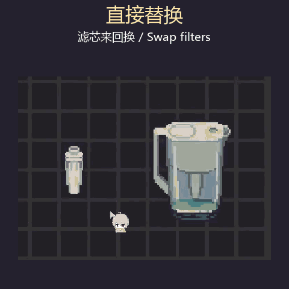
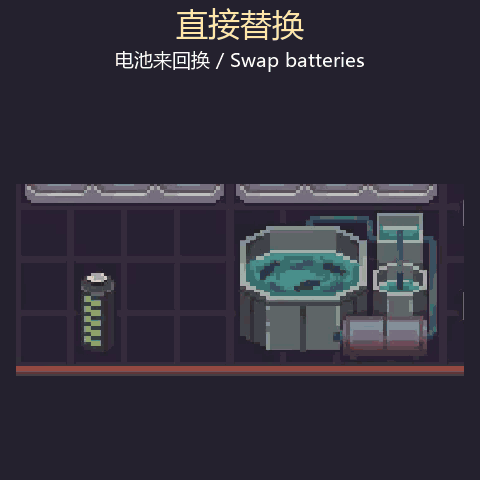

# 直接替换 / Quick Replace

[Steam 创意工坊 / Workshop](https://steamcommunity.com/sharedfiles/filedetails/?id=3831773702) · [下载 / Releases](https://github.com/w7lau/probably-stolen-quick-replace/releases)

把新滤芯拖到水壶上，或把新电池拖到电器上，就能直接换下旧的，不用先取出来。

把电池拖到充电器上，或拖进充电器窗口，就能换出里面剩余电量最多的一块。只换电量比拖入的更高的，低电量和没电的都可以。拖入的留下充电，换出的回到原物品栏。按剩余电量（kJ）比较；没有电量更高的电池时按原方式放入。

旧件会放回新件原来的物品栏，放不下就不换。支持游戏允许安装的滤芯、电池等物品，暂不支持成叠物品。

在游戏 Mod 管理中启用，并重启游戏。

| 换滤芯 / Filters | 换电池 / Batteries |
| --- | --- |
|  |  |

Drag a new filter onto a water pitcher, or a new battery onto an appliance, to replace the old one without removing it first.

Drag a battery onto a charger or into its open window to take the battery with the most remaining energy, only if it has more charge than yours. Both empty and partly charged batteries work. The incoming battery stays to charge, and the other returns to the source inventory. Selection uses remaining kJ. If none has more charge, normal placement applies.

The old item goes back to the inventory the new one came from. If there is no room, nothing is swapped. Works with filters, batteries and other items the device accepts. Stacks are not supported.

Enable the mod in Mod management and restart the game.

## 下载 / Download

从 [Releases](https://github.com/w7lau/probably-stolen-quick-replace/releases) 下载 ZIP，将其中的 `QuickReplace` 文件夹解压到游戏的 `Mods` 目录，在 Mod 管理中启用并重启游戏。

Download the ZIP from Releases, extract `QuickReplace` into the game's `Mods` folder, enable it and restart the game.

## 构建 / Build

需要 .NET SDK 和本地游戏文件。源码使用 MIT 许可，不分发游戏或 Harmony 的程序集。

Requires a .NET SDK and a local game installation. Game and Harmony assemblies are not distributed.

```powershell
./build.ps1 -ManagedDir 'D:\Games\Probably Stolen\Probably Stolen_Data\Managed'
dotnet run --project tests/QuickReplace.Tests.csproj -c Release
```

构建结果在 `dist`。原创代码采用 [MIT License](LICENSE)。
